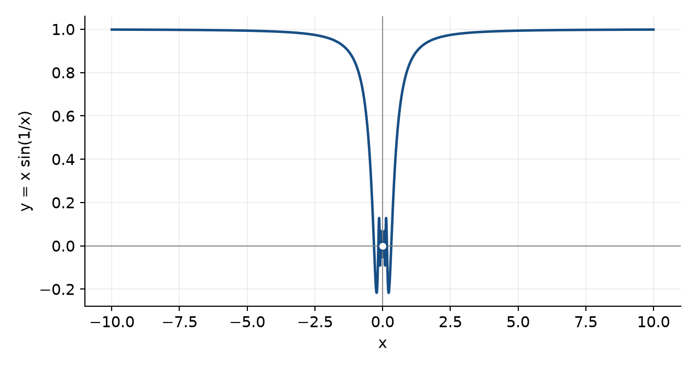
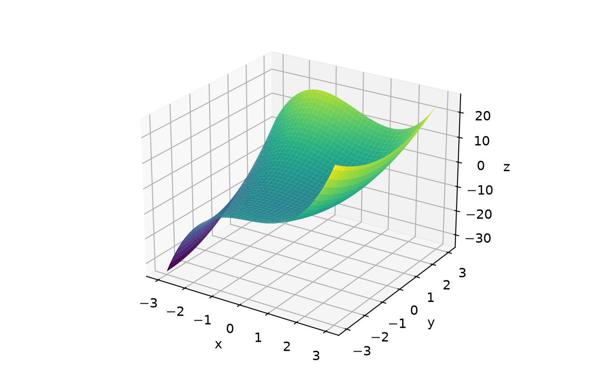
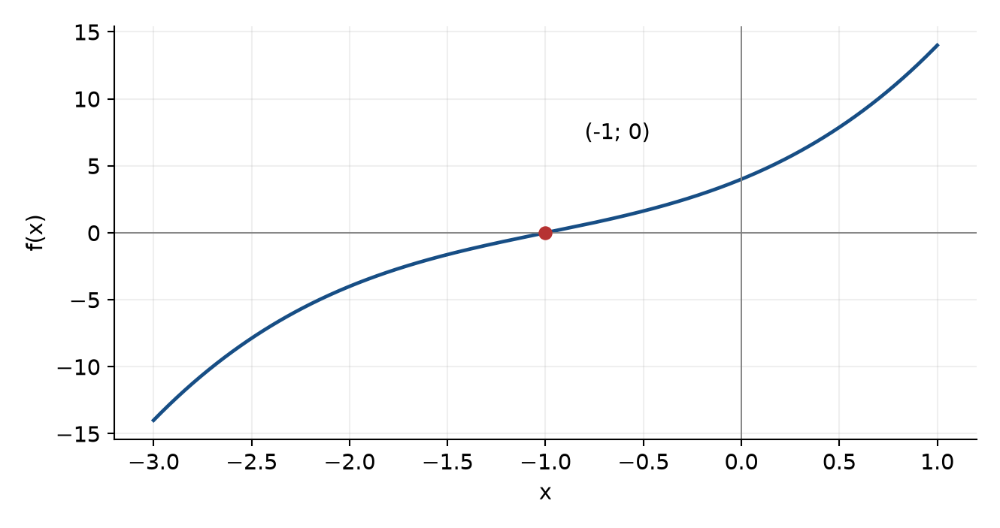

# Вычисление выражений и построение графиков функций в Mathcad

**Вариант 6.** Дубограй Артем Юрьевич, группа 615.

**Цель работы:** изучить вычисление определённых интегралов и конечных сумм, построение графиков функций одной и двух переменных, графическое решение уравнений.

**Источник:** «Методичка по MathCAD(2-е работы)», лабораторная работа 1, вариант 6.

## 1 Вычисление выражений

### Определённый интеграл

I = ∫ от 3 до 10 dx / [x·√(1 + ln x)]. На отрезке [3; 10] функция определена и непрерывна.

Подстановка u = 1 + ln x даёт du = dx/x. Поэтому первообразная равна 2√(1 + ln x).

I = 2√(1 + ln 10) − 2√(1 + ln 3) = **0,737285614006**.

В Mathcad следует вставить шаблон определённого интеграла, заполнить пределы 3 и 10, подынтегральное выражение 1/(x·√(1 + ln(x))) и переменную x; затем вывести значение оператором «=».

### Конечная сумма

S = Σ от k = 1 до 10 [xᵏ·sin(kπ/4)], где x = 7.

Задаём x := 7 и используем шаблон суммы с пределами k = 1…10. Угол kπ/4 задан в радианах.

Проверка по периодичности синуса:

S = 7¹⁰ − 7⁶ + 7² + (7 + 7³ − 7⁵ − 7⁷ + 7⁹)/√2.

**S = 310297988,45884025** (округлённое значение).

<!-- PAGE -->
## 2 График функции одной переменной

Исходная функция: y(x) = x·sin(1/x), x ≠ 0. Для построения выбираем x от −10 до 10, отдельно для положительных и отрицательных значений. Точка x = 0 исключается из вычисления.

При x → 0 имеем |x·sin(1/x)| ≤ |x|, поэтому предел равен 0. В нуле возможна непрерывная доопределённая функция y(0) = 0, но это дополнительное определение, отсутствующее в исходной формуле. На графике исключённая точка отмечена пустым кружком.

Функция чётная: y(−x) = y(x). При |x| → ∞ значение стремится к 1. В Mathcad для графика нужны подписи осей x и y, сетка и диапазон, позволяющий увидеть осцилляции около нуля.

<!-- PAGE -->
## 3 График функции двух переменных

z(x, y) = x³ − xy + y² − 2x + 3y − 4.

Выбираем x, y ∈ [−3; 3] и равномерную сетку. Функция является многочленом, поэтому ограничений области определения нет. В Mathcad можно использовать CreateMesh(z, −3, 3, −3, 3) и график поверхности либо заполнить матрицу значений по индексам и построить Surface Plot.

Проверки отдельных точек: z(0, 0) = −4; z(1, 1) = −2; z(−1, 1) = 2. Оси поверхности подписаны, цвет отражает высоту z.

<!-- PAGE -->
## 4 Графическое решение уравнения

x³ + 3x² + 6x + 4 = 0. Обозначим левую часть f(x).

График пересекает ось Ox при x = −1. Проверка: −1 + 3 − 6 + 4 = 0.

Алгебраически f(x) = (x + 1)(x² + 2x + 4). Второй множитель равен (x + 1)² + 3 > 0 для любого действительного x. Следовательно, **единственный действительный корень x = −1**.

В Mathcad: f(x) := x³ + 3x² + 6x + 4; x₀ := root(f(x), x, −2, 0); затем f(x₀) = 0.

**Вывод:** вычислены интеграл и конечная сумма, построены плоский и пространственный графики. Действительный корень уравнения найден графически и проверен точной подстановкой и разложением многочлена на множители.
