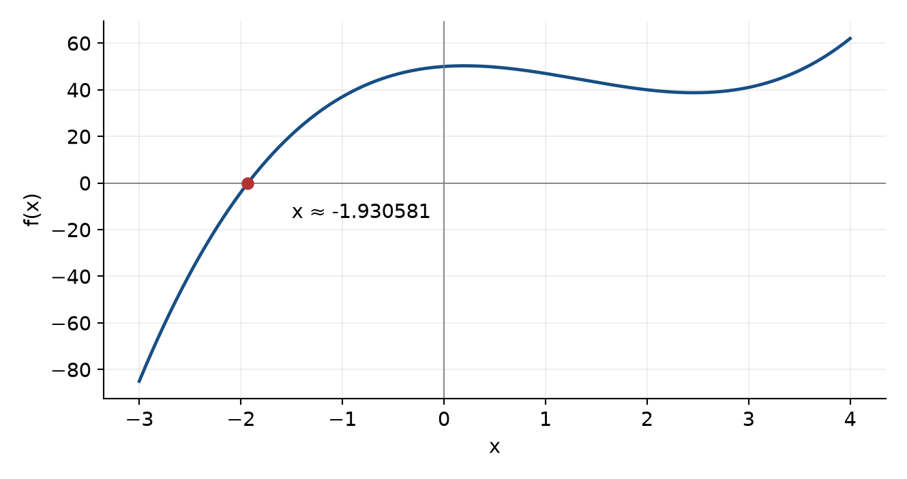
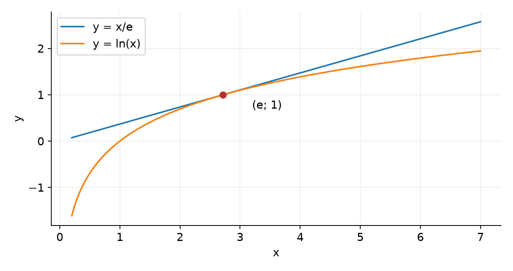

# Работа с массивами и решение систем уравнений в Mathcad

**Вариант 6.** Дубограй Артем Юрьевич, группа 615.

**Цель работы:** изучить операции над матрицами, численное решение уравнений и решение систем линейных и нелинейных уравнений.

**Источник:** «Методичка по MathCAD(2-е работы)», лабораторная работа 2, вариант 6.

## 1 Матричное выражение

Требуется вычислить A = (B − C)·(D − C) + (D − B)·C⁻¹ и найти максимальный элемент. Матрицы размерности 4 × 4 разрешено выбрать самостоятельно. Точки обозначают матричное умножение.

```
B = [2 1 0 1]    C = [1 0 0 0]    D = [4 0 1 0]
    [0 3 1 0]        [0 2 0 0]        [1 5 0 1]
    [1 0 4 1]        [0 0 1 0]        [0 1 6 0]
    [0 1 0 5]        [0 0 0 2]        [1 0 1 7]
```

det(C) = 4 ≠ 0, поэтому обратная матрица существует: C⁻¹ = diag(1; 0,5; 1; 0,5).

```
(B-C)(D-C) = [ 5  3  2  6 ]
             [ 1  4  5  1 ]
             [ 4  3 17  5 ]
             [ 4  3  3 16 ]
```

```
(D-B)C^(-1) = [ 2 -0,5  1 -0,5]
              [ 1  1   -1  0,5]
              [-1  0,5  2 -0,5]
              [ 1 -0,5  1  1  ]
```

```
A = [7  2,5  3   5,5]
    [2  5    4   1,5]
    [3  3,5 19   4,5]
    [5  2,5  4  17  ]
```

**max(A) = 19**, элемент третьей строки и третьего столбца. При ORIGIN := 0 его индекс A₂,₂; при ORIGIN := 1 — A₃,₃. В Mathcad матрицы вводятся через шаблон матрицы; после вычисления A используется функция max(A).

<!-- PAGE -->
## 2 Решение уравнения с заданной точностью

2x³ − 8x² + 3x + 50 = 0, требуемая точность ε = 10⁻⁴. f(−2) = −4; f(−1) = 37, поэтому на [−2; −1] есть корень.

**x = −1,930581179704456**. Абсолютная невязка при вычислении с двойной точностью меньше 10⁻¹². Округление x = −1,93058118 также даёт |f(x)| < 10⁻⁴.

В Mathcad: TOL := 10⁻⁴; f(x) := 2x³ − 8x² + 3x + 50; x₀ := root(f(x), x, −2, −1); вывести x₀ и f(x₀). Для отображения результата следует установить не менее 8 знаков после запятой.



Производная 6x² − 16x + 3 обращается в нуль при (8 ± √46)/6. Значения исходного многочлена в обеих стационарных точках положительны. С учётом поведения кубической функции при x → ±∞ действительный корень единственный.

<!-- PAGE -->
## 3 Система линейных уравнений

```
x + y - z  = 0
x + y + 2z = 9
x + y + z  = 6
```

Матрица коэффициентов M = [[1,1,−1]; [1,1,2]; [1,1,1]], столбец правых частей b = [0; 9; 6]. Первые два столбца совпадают, поэтому det(M) = 0 и обратной матрицы M⁻¹ не существует.

Вычтем первое уравнение из второго и третьего: 3z = 9; 2z = 6. Оба дают z = 3, после чего x + y = 3.

**Общее решение: x = t; y = 3 − t; z = 3, t ∈ ℝ.** Ранг матрицы и расширенной матрицы равен 2, неизвестных 3; система совместна и имеет одну свободную переменную.

Предписанные в методичке способы имеют ограничения:

1. Формула X = M⁻¹·b неприменима: матрица вырождена. Ошибка вычисления обратной матрицы отражает свойства условия, а не отсутствие решения.

2. Функция lsolve(M, b) рассчитана на получение определённого решения при подходящих свойствах матрицы; для этой вырожденной системы единственное решение не определено. Результат либо сообщение программы нельзя трактовать как доказательство отсутствия решений.

В Mathcad корректно задать X(t) := [t; 3 − t; 3] и вычислить M·X(t) − b. Получается нулевой вектор при любом t. Например, при t = 1: X = [1; 2; 3]; левая часть системы равна [0; 9; 6].

Если преподаватель ожидает единственное решение обоими указанными способами, требуется уточнение исходных коэффициентов. Самостоятельно изменять систему нельзя.

<!-- PAGE -->
## 4 Система нелинейных уравнений

y = x/e; y = ln x, область определения x > 0. Получаем g(x) = x/e − ln x = 0.

Производная g′(x) = 1/e − 1/x равна нулю только при x = e. При x < e функция убывает, при x > e возрастает. Минимум равен g(e) = 1 − 1 = 0.

**Единственное решение: (x, y) = (e, 1) ≈ (2,718281828459; 1).** Графики касаются, поэтому поиск корня только по смене знака g(x) может не обнаружить решение.



Для Mathcad можно задать начальные приближения x := e; y := 1, затем блок Given с двумя уравнениями и Find(x, y). В блоке условий знак равенства вводится как булево равенство. Результат проверяется вычислением y − x/e и y − ln(x): обе невязки равны нулю.

**Вывод:** вычислено матричное выражение и найден его максимальный элемент; численно решено кубическое уравнение. Для вырожденной линейной системы получено полное семейство решений, а для нелинейной системы установлено единственное решение и объяснена особенность касания графиков.
